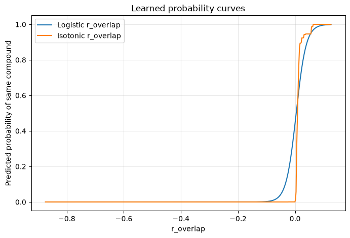

# Min–Max Mass Spectral Probability Calibration

**Turning replicate-based spectral comparison scores into estimated same-compound probabilities.**

MSc project by **Amirhossein Sorour**, developed for **AMOD 5640Y — Data Science and Analytics Practicum**, Trent University, Summer 2026.

[Final report](reports/final_report.pdf) · [Presentation](reports/final_slides.pdf) · [Methodology](docs/methodology.md) · [Data documentation](data/README.md) · [Reproducibility](docs/reproducibility.md)

## Research question

Can the min–max mass spectral comparison statistic be mapped to useful same-compound probabilities, and how do logistic and isotonic calibration compare?

GC–EI–MS spectra provide chemical fingerprints, but a similarity score does not directly express a probability. This project builds a supervised calibration layer on the replicate-based min–max test introduced by [Moorthy and Sisco (2021)](https://doi.org/10.1021/acs.analchem.1c03053). The analysis starts from **precomputed Identity Match Factor comparison summaries**, rather than recomputing similarity scores from raw spectra.

## Main findings

The full study used **2,073,600 comparisons**, including **14,400 same-compound comparisons (0.694%)**. An 80/20 stratified split of unique, unordered compound pairs kept repeated comparisons of a pair together. The held-out set contained **414,700 rows from 2,088 pairs**, including 2,900 positive rows.

| Model | Brier score ↓ | Log loss ↓ | ROC–AUC ↑ | Average precision ↑ | Precision ↑ | Recall ↑ | F1 ↑ |
| --- | ---: | ---: | ---: | ---: | ---: | ---: | ---: |
| Logistic — `r_overlap` | 0.000798 | 0.003153 | 0.999907 | **0.982432** | 0.940851 | **0.998276** | **0.968713** |
| Isotonic — `r_overlap` | **0.000403** | **0.001614** | **0.999908** | 0.980183 | **0.953418** | 0.981034 | 0.967029 |
| Expanded logistic | 0.001198 | 0.003974 | 0.999813 | 0.975916 | 0.939347 | 0.833103 | 0.883041 |

**Isotonic regression achieved the lowest probability losses; logistic regression offered a smooth, interpretable baseline with higher recall.** At a 0.5 threshold, logistic regression produced 182 false positives and 5 false negatives; isotonic regression produced 139 and 55, respectively. The expanded model did not improve the reported results under the chosen fitting settings.

These are **historical full-study results**, checked against the final report and saved notebook outputs. They are not results from the included sample or an independent rerun of the full experiment. The report's “PR-AUC” is calculated with `average_precision_score`; it is labelled **average precision (AP)** here. See the [result tables and provenance](results/README.md).



*The figure is extracted from the saved full-study notebook output. The included sample is for demonstrating the workflow.*

## Method

The raw min–max statistic compares the weakest within-sample similarity with the strongest between-sample similarity:

$$
w = \min(\mathrm{minS11},\mathrm{minS22}),\qquad
\delta = w-\mathrm{maxS12}.
$$

The original transformed score, $\delta'=1-\max(0,\delta)$, maps every nonpositive $\delta$ to 1. To retain variation in this region and align the score with the positive class, the project reconstructs:

$$
r_{\mathrm{overlap}}=-\delta=\mathrm{maxS12}-w.
$$

Three models estimate $P(y=1)$, where `1` denotes the same exact compound code:

| Model | Predictors | Role |
| --- | --- | --- |
| Logistic regression | `r_overlap` | Smooth, interpretable single-score mapping |
| Increasing isotonic regression | `r_overlap` | Flexible monotonic mapping |
| Expanded logistic regression | `within_min`, `maxS12` | Tests the two components separately |

All models use the same pair split (`random_state=85`). Logistic models retain the observed class proportions without class weighting or resampling. Evaluation covers probability losses, reliability curves, ranking metrics and threshold-based classification. Full settings and interpretation are in [methodology](docs/methodology.md).

## What is included

| Location | Contents |
| --- | --- |
| [`notebooks/`](notebooks/README.md) | Four numbered notebooks: preprocessing, EDA, calibration and evaluation |
| [`data/sample/`](data/sample/README.md) | One documented IdentityMF input example: 20,736 precomputed comparison rows |
| [`reports/`](reports/README.md) | Final report, presentation and historical proposal |
| [`results/`](results/README.md) | Aggregate full-study metrics, confusion matrices and coefficients |
| [`assets/`](assets/README.md) | Selected figures extracted from saved full-study notebook outputs |
| [`docs/`](docs/reproducibility.md) | Method, reproducibility limits and source provenance |
| [`project_config.py`](project_config.py) | Shared sample/full input and output paths |
| [`scripts/run_notebooks.py`](scripts/run_notebooks.py) | Headless execution of the four notebooks' Python code cells |

The complete raw spectra, full comparison tables, processed datasets, row-level prediction files and fitted model objects are **not distributed**. The small example contains comparison summaries, **not raw mass spectra**. Data attribution and upstream access are documented in [data/README.md](data/README.md) and [THIRD_PARTY_NOTICES.md](THIRD_PARTY_NOTICES.md).

## Run the sample

Use **Python 3.12**. From the repository root, create an environment:

```bash
python -m venv .venv
```

On **Windows PowerShell**:

```powershell
.venv\Scripts\python.exe -m pip install -r requirements.txt
.venv\Scripts\python.exe scripts/run_notebooks.py --mode sample
```

On **macOS/Linux**:

```bash
.venv/bin/python -m pip install -r requirements.txt
.venv/bin/python scripts/run_notebooks.py --mode sample
```

The script runs the notebooks' pure-Python code cells in order, with a fresh namespace for each notebook and a noninteractive plotting backend. It writes processed files to `data/processed/sample/` and evaluation tables, plots and logs to `outputs/sample/`. These generated directories are ignored by Git. It does not create executed Jupyter notebook files.

For an interactive interface, install `requirements-notebooks.txt` using the same environment, start `python -m jupyterlab`, and run the notebooks in numerical order with that environment's kernel. The notebooks default to sample mode. See [reproducibility](docs/reproducibility.md) for environment activation and full-data instructions.

**The sample validates execution, not the reported performance.** It contains only 144 positive rows before splitting and only 29 in the test set. Its training size and fitted probabilities differ substantially from the full study.

## Interpretation and limitations

- The split is **pair-disjoint**, not compound-disjoint: individual compounds and underlying replicate measurements can recur across different pairs in both sets.
- Probabilities reflect the comparison dataset and its approximately 0.7% positive prevalence. They are not universal chemical-identity probabilities or validated forensic likelihood ratios.
- Results come from one held-out split of one experimental collection. Independent laboratory, instrument and compound-set validation was not performed; confidence intervals were not reported.
- The logistic models use default L2 regularization. Their comparison depends on feature parameterization and fitting settings. Coarse quantile calibration plots also have limited resolution in this highly imbalanced setting.

The [methodology](docs/methodology.md#interpretation-and-future-validation) expands these limitations and the next validation steps.

## References and attribution

Moorthy, A. S., & Sisco, E. (2021). *The min-max test: an objective method for discriminating mass spectra.* Analytical Chemistry, 93(39), 13319–13325. [DOI](https://doi.org/10.1021/acs.analchem.1c03053).

Upstream data and source code: [NIST — Supplemental Data and Source Code for Min-Max Test Research](https://data.nist.gov/od/id/mds2-2418). This repository contains the project's Python calibration workflow, not the upstream C++ and R implementation.

Project citation metadata is provided in [CITATION.cff](CITATION.cff). No open-source license has been assigned to the project code or documents. The NIST-derived sample has its own [notice and terms](THIRD_PARTY_NOTICES.md).
