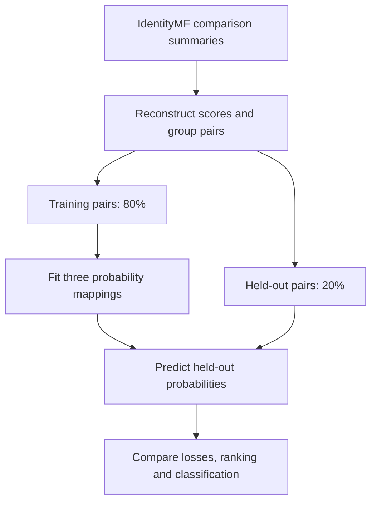

# Methodology and interpretation

## Scope

This project studies **score-to-probability calibration** for replicate-based mass spectral comparisons. The label is exact compound-code identity: `1` means the two compared replicate groups belong to the same standard; `0` means different standards.

The project starts from the precomputed **Identity Match Factor min–max** table supplied with the work of [Moorthy and Sisco (2021)](https://doi.org/10.1021/acs.analchem.1c03053). It does not acquire spectra, perform peak detection, implement the upstream similarity algorithms, identify compounds from a spectral library, or train a model directly on spectral peaks.

The upstream min–max test was designed to support discrimination, particularly evidence that two samples are different. This project adds a supervised, dataset-conditional probability mapping; failure to distinguish two spectra is not by itself proof of chemical identity.

## Score reconstruction

For a replicate selection, let:

- `minS11` be the minimum within-sample similarity in the first sample;
- `minS22` be the corresponding minimum for the second sample;
- `maxS12` be the maximum similarity across the two replicate groups.

The notebook computes:

$$
w=\min(\mathrm{minS11},\mathrm{minS22}),\quad
\delta=w-\mathrm{maxS12},\quad
r=\mathrm{maxS12}-w=-\delta.
$$

A positive $\delta$ means even the weakest within-sample match exceeds the strongest cross-sample match. Increasing $r$ reverses that direction so that it indicates greater spectral overlap, making it a natural input for modelling the positive class.

The stored paper index is checked against $\delta'=1-\max(0,\delta)$. Every $\delta\leq0$ maps to 1, removing distinctions among overlapping comparisons. The full-study report found `delta_prime == 1` for 14,398 of 14,400 positive rows, versus 2,505 of 2,059,200 negative rows. Reconstruction from the rounded source components differs from the stored index by at most approximately `1e-6`. The public notebook uses `atol=2e-6, rtol=0` to accept this rounding without accepting larger inconsistencies.

The score transformation is fixed arithmetic. It is not a preprocessing parameter estimated from the test labels.

## Grouped train/test split

For each comparison, the two compound codes are sorted and joined to form `pair_id`. Thus A–B and B–A share a group, and all repeated selections for that pair stay together.

The split operates on one row per unique `pair_id`, using `train_test_split(test_size=0.20, stratify=label, random_state=85)`. The resulting pair memberships select the original rows without changing their order. Each pair must have one label, and train/test pair intersections must be empty.

| Quantity | Full | Train | Test |
| --- | ---: | ---: | ---: |
| Unordered pairs | 10,440 | 8,352 | 2,088 |
| Same-compound pairs | 144 | 115 | 29 |
| All comparison rows | 2,073,600 | 1,658,900 | 414,700 |
| Same-compound rows | 14,400 | 11,500 | 2,900 |
| Different-compound rows | 2,059,200 | 1,647,400 | 411,800 |

Different-compound unordered pairs contribute 200 full-study rows, while self-pairs contribute 100. Consequently pair-level positive prevalence is approximately 1.38%, whereas row-level prevalence is approximately 0.694%. Stratification uses the **pair** labels.

This prevents repeated **pairs** from appearing in both sets. It does not ensure that individual compounds, source spectra or replicate selections are disjoint across sets: the same compound can be paired with different partners. The design evaluates new pairs within the source collection, not transfer to entirely unseen chemistry or laboratories.

## Models and fitting settings

| Model | Implementation | Inputs | Settings retained from the notebooks |
| --- | --- | --- | --- |
| Single-score logistic | `sklearn.linear_model.LogisticRegression` | `r_overlap` | `solver="lbfgs"`, `max_iter=1000`; other defaults retained |
| Increasing isotonic | `sklearn.isotonic.IsotonicRegression` | `r_overlap` | `y_min=0`, `y_max=1`, `increasing=True`, `out_of_bounds="clip"` |
| Expanded logistic | `sklearn.linear_model.LogisticRegression` | `within_min`, `maxS12` | Same logistic settings |

The models are fitted directly to the fixed comparison features and training labels. There is no separately trained spectral classifier whose predictions require a second calibration split. No oversampling, class weighting, feature scaling, cross-validation or hyperparameter search is present in the supplied modelling code.

In the pinned verification environment, the logistic defaults include **L2 regularization with `C=1.0`**, an intercept, and `tol=1e-4`. These are regularized fits, not unpenalized statistical logistic regressions. See the official [LogisticRegression documentation](https://scikit-learn.org/stable/modules/generated/sklearn.linear_model.LogisticRegression.html).

The single-score logistic form is

$$
P(y=1\mid r)=\frac{1}{1+\exp[-(\beta_0+\beta_1r)]}.
$$

Its reported coefficients are $\beta_0=-0.22620851074886983$ and $\beta_1=57.44204286384675$. The expanded fit uses separate coefficients for $w$ and `maxS12`; historical coefficients are listed in [`results/reported_coefficients.csv`](../results/reported_coefficients.csv). Isotonic regression learns an increasing piecewise mapping instead of a single sigmoid. It can create ties and exact 0/1 outputs, and its out-of-range predictions are clipped to the fitted boundary values.

## Evaluation definitions

All three models use the same held-out observations. In the public evaluation notebook, all 12 base-data columns must agree across the three prediction files, in row order, before probabilities are compared. This is stronger than checking only pair identifiers, which repeat.

| Aspect | Computation |
| --- | --- |
| Probability loss | `brier_score_loss`; `log_loss` after clipping to `[1e-15, 1-1e-15]` in final evaluation |
| Ranking | `roc_auc_score`; `average_precision_score` |
| Binary decision | Positive prediction when `probability >= 0.5` |
| Classification | Accuracy, precision, recall, specificity, false positive rate and F1 |
| Reliability plot | `calibration_curve(n_bins=10, strategy="quantile")` |
| Other plots | ROC, precision–recall and class-conditional probability histograms |

The legacy metric name `pr_auc` is retained in the output CSV schema to match the original notebooks. Its actual computation is **average precision**, not trapezoidal integration of the PR curve. The distinction is documented by [scikit-learn](https://scikit-learn.org/stable/modules/generated/sklearn.metrics.average_precision_score.html).

The Brier score and log loss assess overall probability prediction quality; they are not pure calibration-error measures independent of discrimination. Their interpretation is supplemented by reliability diagrams and the dataset's prevalence. Accuracy alone is especially weak evidence here because most comparisons are negative.

## Interpretation and future validation

The historical experiment supports a specific conclusion: **in this split of the IdentityMF comparison dataset, isotonic regression had the lowest Brier score and log loss, while the single-score logistic fit had higher recall and AP.** It does not establish statistical significance or universal superiority.

Several issues remain relevant for extending the work:

1. **Independent validation.** Hold out complete compounds, source spectra, experimental batches or laboratories according to the intended use. Pair grouping alone does not provide these stronger forms of separation.
2. **Dependence and uncertainty.** Millions of rows reuse only 144 standards and repeated spectra. Row count is not the number of independent chemical samples. Use an appropriate grouped resampling design for uncertainty estimates; ordinary row bootstrap intervals would ignore this structure.
3. **Prevalence and target interpretation.** Same-compound prevalence is induced by the all-pairs construction. A different reference library or case-selection process changes the relevant prior. Treat the outputs as probabilities conditional on this benchmark; a forensic likelihood ratio or case-level source probability needs a separate, validated framework.
4. **Regularization and the expanded model.** Since `r_overlap = maxS12 - within_min`, the two-feature logistic family can represent the one-feature linear predictor. Default L2 penalties act differently in these parameterizations. The expanded fit's worse performance therefore does not prove that the components lack information. Investigate regularization, convergence and grouped validation before making that stronger claim.
5. **Calibration-plot resolution.** With less than 1% positives, ten quantile bins can combine many low-probability observations and give little detail at high probabilities. Tied isotonic outputs can further reduce the number of occupied bins. Add probability-bin counts, suitable alternative binning and uncertainty estimates; see [calibration_curve documentation](https://scikit-learn.org/stable/modules/generated/sklearn.calibration.calibration_curve.html).
6. **Threshold choice and selection.** The 0.5 threshold is fixed, not tuned for forensic error costs. Model comparison uses one test split; no separate final external test set or confidence intervals were supplied.

The [historical proposal](../reports/project_proposal.pdf) also discussed cosine-based calibration, an original-threshold benchmark and runtime comparison. Those extensions are not implemented in the four final notebooks and are not claimed as completed results here.
